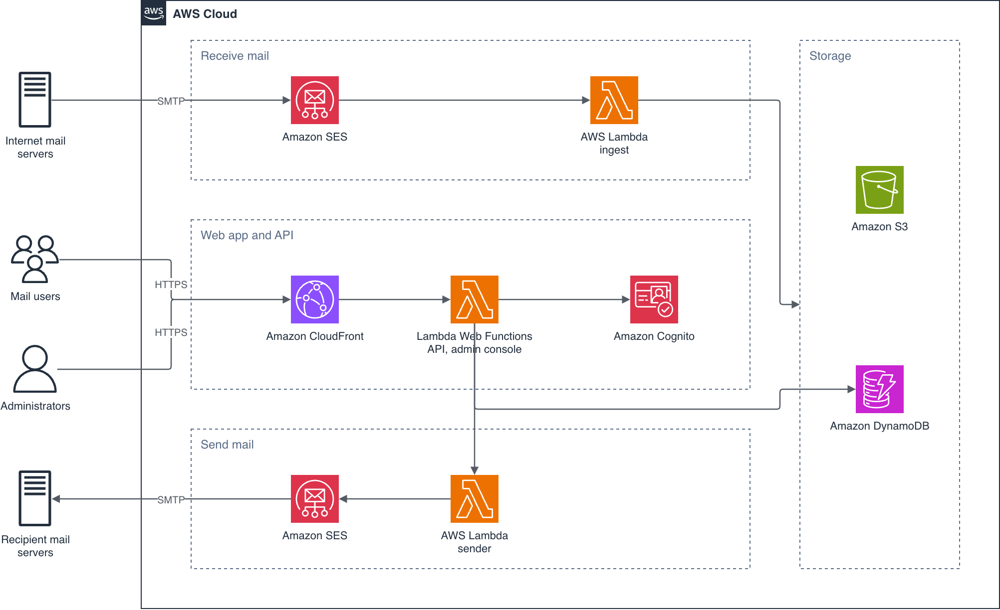

# sesame: Serverless Email, Storage And Messaging Engine

sesame is a personal project that runs a complete mail system for your own domain on serverless AWS services: receiving, sending, storage, search, a web app, and sync with the iPhone's built-in Mail app. It shows how to build a stateful, multi-component application that scales to zero, and how to serve a web API from [AWS Lambda Web Functions](https://aws.amazon.com/lambda/) behind Amazon CloudFront.

An idle deployment costs about $0.50 a month, and a 10-person deployment about $3–4 (see [docs/cost.md](docs/cost.md)).

> [!IMPORTANT]
> This is a personal proof of concept for learning and experimentation. It isn't a supported product and hasn't been hardened for production mail, so review it carefully before you trust it with real mailboxes. Deploying it creates AWS resources in your account that you're billed for.

## Contents

- [What sesame shows](#what-sesame-shows)
- [Architecture](#architecture)
- [Lambda Web Functions in sesame](#lambda-web-functions-in-sesame)
- [Prerequisites](#prerequisites)
- [Deploy](#deploy)
- [Clean up](#clean-up)
- [Cost](#cost)
- [Security considerations](#security-considerations)
- [Repository layout](#repository-layout)
- [Development](#development)
- [Security](#security)
- [License](#license)

## What sesame shows

- **A web API on Lambda Web Functions.** The API is a plain Node.js HTTP server (Hono), with no event adapter. CloudFront signs requests to it with origin access control, so there is no API Gateway and no shared secret.
- **Scale to zero.** Every component costs nothing when idle: no VPC, NAT gateway, OpenSearch, RDS or always-on compute.
- **Event-driven mail pipelines.** Amazon SES, Amazon SNS, Amazon SQS and AWS Lambda receive and send mail, with idempotent consumers and dead-letter queues that are safe to redrive.
- **DynamoDB single-table patterns**, including full-text search on a token index instead of a search cluster.
- **Phones on Exchange ActiveSync.** A third Web Function speaks ActiveSync 14.1, so iPhone Mail syncs, sends and, optionally, gets push, with no mail server running.
- **Federated sign-in** through Amazon Cognito, which can trust any SAML or OIDC identity provider, with a backend-for-frontend session cookie.
- **Infrastructure as code** in Terraform modules, using the `hashicorp/awscc` provider for the new Web Function resources.

## Architecture



- **Receive:** SES writes the raw MIME to S3 and publishes a notification with the envelope recipients and the spam, virus, SPF, DKIM and DMARC verdicts. The `ingest` Lambda parses the message, sanitizes HTML, indexes it for search and delivers it to each mailbox.
- **Send:** the API builds the MIME once. Recipients in the directory are delivered through the same ingest pipeline without touching SES; everyone else goes through SES. Bounces and complaints flow back to update delivery status and the suppression list.
- **Read:** a React single-page app on S3 and CloudFront calls the API on the same origin. Message bodies render in a sandboxed iframe.
- **Phones:** iPhones sign in to the `eas` Web Function with an app password, through the same distribution. It reads the same tables and objects as the API, and sends through the same routing.

## Lambda Web Functions in sesame

sesame runs three Web Functions behind one CloudFront distribution: the JSON API for the mail app at `/api`, a server-rendered admin console at `/admin`, and ActiveSync for phones at `/Microsoft-Server-ActiveSync`. [`packages/api`](packages/api), [`packages/admin`](packages/admin), [`packages/eas`](packages/eas) and the [`web`](infra/modules/web) Terraform module are the parts to read if you're here for Web Functions:

- **The function is just a server.** It listens on the address in `AWS_LAMBDA_HTTP_ENDPOINT`. The runtime starts `server.mjs`, named by `AWS_LAMBDA_NODEJS_ENTRYPOINT`.
- **Three resources, from `awscc`.** `awscc_lambda_web_function` is the container, `awscc_lambda_web_function_revision` is immutable code and configuration, and `awscc_lambda_web_function_endpoint` is the HTTPS endpoint, with scaling and throttling limits.
- **CloudFront is the only caller.** The endpoints use `IamAuth`. CloudFront signs requests with origin access control (origin type `lambda`), and the function's resource policy allows `lambda:InvokeWebFunctionEndpoint` only from this distribution. The `/api/*` behavior drops the viewer's `Host` header.
- **Deploys without downtime.** Each deploy creates a new revision before the old one is deleted. The endpoint's `revision_weights` also allow blue/green splits between two revisions.
- **Runtime configuration from SSM.** Values that depend on the endpoint, such as the CloudFront domain and the Cognito client, live in an SSM parameter, which avoids a dependency cycle with the revision.

### Why this API runs on a Web Function

The mail web app itself doesn't need a Web Function. It's static files on S3, cached by CloudFront. The mail pipelines don't use one either: `ingest`, `sender` and `ses-events` are SQS consumers, which is what classic event-driven Lambda functions are for. sesame uses Web Functions where it serves HTTP. For the API, that buys three things:

- **Ordinary server code.** The API is a Hono app on Node's HTTP server ([`server.ts`](packages/api/src/server.ts)). It runs unchanged with `node` on a laptop, and its tests call it like any web server. There's no event adapter in the deployed path.
- **You don't pay for waiting.** A typical request spends most of its time waiting on DynamoDB, S3, SQS or Cognito. Web Functions bill active CPU, not wall-clock time, so that wait is free. The test deployment measured about 100 ms of CPU per request; see [docs/cost.md](docs/cost.md#web-app-and-api).
- **One environment serves many requests at once.** `max_concurrency_per_environment` (64 by default) lets every open browser tab's 60-second poll share one warm environment, where classic Lambda would run one environment per concurrent request. The test deployment, with one or two users, peaked at 2 concurrent requests, so this benefit shows up with more people.

The same app can also be packaged as a classic Lambda function behind a function URL ([`lambda.ts`](packages/api/src/lambda.ts)), as a fallback where Web Functions aren't available. That path is built but not deployed or tested on AWS. Comparing the two entry points shows how little of the app depends on the runtime.

### The admin console: a whole web app on a Web Function

The admin console ([`packages/admin`](packages/admin)) shows the other side of Web Functions. It isn't an API behind a single-page app: it's a complete web application that renders HTML on the server, with Hono's JSX. Its forms post back to it, and it ships no client-side JavaScript. Administrators use it to:

- check SES sending status, the alarms and queue depths;
- manage domains, mailboxes, quotas, aliases and access, and delete mailboxes with all their mail;
- clear the suppression list;
- redrive dead-lettered mail;
- review an activity log of every change.

It runs as its own function, so it gets its own boundaries:

- **Its own IAM role.** It can manage the directory, queues and alarms, but it has no access to the mail bucket or the mail table, so an administrator can't read anyone's mail through it.
- **Its own limits.** A handful of administrators never needs more than one environment, so the endpoint caps it at two.
- **A shared front door.** It sits behind the same distribution and origin access control as the API. It reuses the same sign-in and session cookie, and admits only members of the `<name>-admins` Cognito group.
- **A locked-down page.** There's no client JavaScript, so its content security policy allows no scripts at all.

For a low-traffic, form-heavy tool like this, server rendering on a Web Function means no separate JSON API, no client bundle, and an authorization check on every request.

### ActiveSync: a protocol server on a Web Function

[`packages/eas`](packages/eas) serves Exchange ActiveSync 14.1, the protocol iPhone Mail uses for Exchange accounts. A user creates an app password on the web app's **Phones and devices** page and adds an Exchange account on the phone. Mail, read and flag state, moves and deletes then stay in step both ways, and the phone can send, reply and forward. Only mail is synced: no calendar, contacts or device policies.

It shows what Web Functions do with a protocol that isn't a web app:

- **Two layers of auth.** Lambda refuses resource policies that would make a Web Function public, so this endpoint uses `IamAuth` too, behind the same distribution. CloudFront signs each request with origin access control and passes the phone's own `Authorization` header through, and the function checks those HTTP Basic credentials against hashed app passwords on every request. A dedicated cache policy keys on `Authorization`, because CloudFront forwards it only then. Failed attempts are throttled per username and per IP (from `CloudFront-Viewer-Address`), and access follows mailbox membership, checked each time.
- **Binary bodies, ordinary code.** Requests and responses are WBXML, a compact binary XML, with a small codec in the package. Attachments can go back as multipart responses.
- **Long polls are cheap.** Push is ActiveSync's `Ping`: the phone holds a request open while the server watches its folders. Web Functions bill CPU, not wall-clock time, and one environment holds up to 64 phones' requests, so waiting costs memory for one environment rather than one function per phone. CloudFront's origin read timeout (60 seconds, or 180 with a quota increase) caps how long each `Ping` lasts. Push is off unless you set `eas_push = true`; see [docs/cost.md](docs/cost.md#phones-activesync).
- **No server-side sessions.** Sync state is a compact snapshot per phone and folder in DynamoDB, diffed against the folder on each request, so any environment can serve any request.
- **Its own role and limits.** It can read and change mail and queue outgoing mail, with no access to Cognito or the admin operations. Its endpoint's scaling and rate limits cap what a flood of requests can cost.

[docs/decisions.md](docs/decisions.md#22-activesync-on-its-own-web-function-with-app-passwords) explains the design, and [docs/quickstart.md](docs/quickstart.md#12-phones-activesync) sets up a phone.

## Prerequisites

- An AWS account, and credentials for it (`AWS_PROFILE` or environment variables).
- A Region where both Lambda Web Functions and SES email receiving are available.
- A domain or subdomain whose DNS you control, ideally in Amazon Route 53, that doesn't already receive mail elsewhere. Its MX record will point at SES.
- Node.js 24 or later, pnpm, and Terraform 1.10 or later (or OpenTofu).
- An S3 bucket for Terraform state.

Receiving works while your account is in the SES sandbox. Sending to arbitrary external recipients needs [SES production access](docs/operations.md#ses-production-access).

## Deploy

```bash
pnpm install
pnpm build

cd infra/examples/single-domain
cp terraform.tfvars.example terraform.tfvars   # set domain, region, sign-in
cp backend.hcl.example backend.hcl             # set your state bucket
terraform init -backend-config=backend.hcl
terraform apply

cd ../../..
scripts/deploy-web.sh
```

Then publish the DNS records, create mailboxes with the admin CLI, and sign in. [docs/quickstart.md](docs/quickstart.md) walks through each step, including test messages, sending, search and alarms. [docs/operations.md](docs/operations.md) is the runbook for alarms, dead-lettered mail, full mailboxes, SES reputation, backups and updates.

## Clean up

Destroying the stack deletes all stored mail. From `infra/examples/single-domain`:

1. Set `force_destroy = true` in `terraform.tfvars` and run `terraform apply`. This removes deletion protection from the DynamoDB tables and the Cognito user pool, and lets Terraform delete the mail bucket while it holds objects.
2. Run `terraform destroy`.
3. If you published DNS records outside Route 53, remove them. Delete the Terraform state bucket if you no longer need it.

## Cost

sesame uses only pay-per-use services, so cost follows mail volume and use of the web app. As of October 2026, in us-east-1:

| Scenario                    | Monthly cost |
| --------------------------- | ------------ |
| Idle (Route 53 hosted zone) | about $0.50  |
| 1,000 messages received     | about $0.30  |
| 1,000 messages sent         | about $0.20  |
| 10 people, typical use      | about $3–4   |
| Each phone on ActiveSync    | a few cents  |
| Push for phones (optional)  | about $1.90  |

[docs/cost.md](docs/cost.md) has the breakdown and assumptions. Check current AWS pricing before you rely on these numbers.

## Security considerations

sesame makes trade-offs to keep idle cost near zero. Review them before you deploy it anywhere that matters:

- **No AWS WAF.** CloudFront is the only path to the API, but it has no web ACL. Add one if you expose the app widely.
- **Encryption.** By default the mail bucket uses SSE-S3 and the tables use DynamoDB's AWS owned key. The storage, inbound and web modules accept a customer-managed KMS key.
- **Backups are off.** DynamoDB point-in-time recovery is disabled and the mail bucket isn't versioned. See [Backups and recovery](docs/operations.md#backups-and-recovery).
- **Sign-in.** Mailbox access is granted by the signed-in user's email, so every identity provider must supply a verified `email` claim. Use `allow_cognito_users` only for testing.
- **Mail content.** HTML is sanitized at ingest and rendered in a sandboxed iframe with a restrictive content security policy, and remote images stay blocked until the user allows them. Mail content never appears in alarm notifications.
- **Phones sign in with passwords.** ActiveSync is the one endpoint that accepts a password straight from the internet, with no WAF in front. App passwords carry about 120 bits of entropy and are stored only as hashes; failures are throttled; the endpoint's rate limit caps cost. Disabling someone in your identity provider doesn't stop their app passwords: remove their mailbox membership, which cuts their phones off at once.
- **Phones get the original message.** iPhone Mail receives each message's original MIME, not the sanitized HTML, and applies its own protections, such as its remote-content setting. There's no device policy (passcode rule) or remote wipe; revoke a lost phone's app password instead.
- **Sending reputation.** Mail you send affects your SES account's reputation. sesame enforces a per-user send rate and a suppression list, and alarms on bounce and complaint rates.

## Repository layout

| Path                           | Contents                                                   |
| ------------------------------ | ---------------------------------------------------------- |
| `packages/core`                | Shared types, DynamoDB key builders, address handling, IDs |
| `packages/api`                 | HTTP API (Hono) on a Lambda Web Function                   |
| `packages/admin`               | Server-rendered admin console on a second Web Function     |
| `packages/eas`                 | Exchange ActiveSync for phones, on a third Web Function    |
| `packages/ops`                 | Directory and queue operations shared by the CLI and admin |
| `packages/ingest`              | Inbound and internal delivery                              |
| `packages/sender`              | Outbound delivery through SES                              |
| `packages/ses-events`          | Delivery, bounce and complaint handling                    |
| `packages/purge`               | Deletes a removed mailbox's mail in the background         |
| `packages/web`                 | React + Vite single-page app                               |
| `packages/cli`                 | Admin CLI                                                  |
| `infra/modules`                | Terraform modules                                          |
| `infra/examples/single-domain` | Example deployment                                         |
| `scripts`                      | Lambda bundling and web app deployment                     |
| `docs`                         | Quickstart, operations runbook, cost model, decisions      |

## Development

```bash
pnpm install
pnpm test
pnpm typecheck
pnpm lint
```

## Security

Please report security problems privately, as described in [SECURITY.md](SECURITY.md). [CONTRIBUTING.md](CONTRIBUTING.md) covers issues and pull requests.

## License

sesame is released under the [MIT License](LICENSE).

sesame is an independent project. It isn't affiliated with, endorsed by or supported by Amazon Web Services. AWS and the names of AWS services are trademarks of Amazon.com, Inc. or its affiliates.
